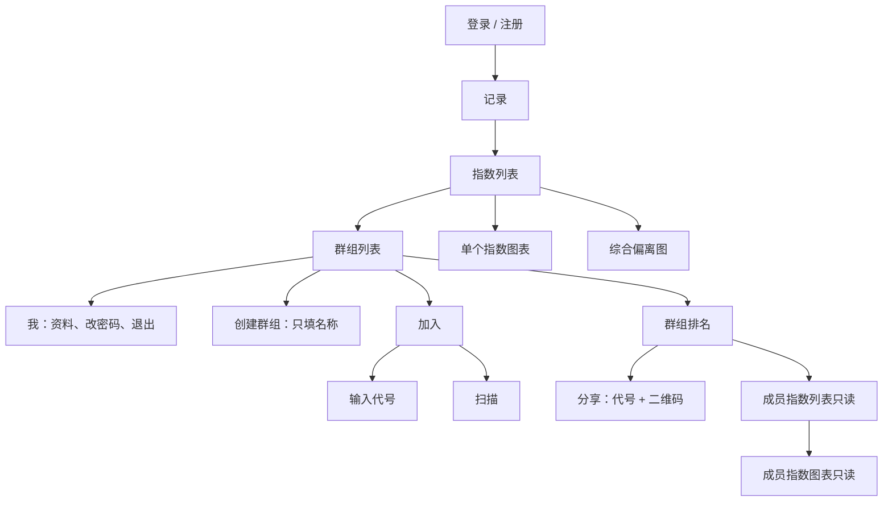

# 蓝图：家庭健康指标追踪器（初版）

> 编码前的设计冻结稿。版本 0.4：最主要的使用场景改为手机竖屏。电脑浏览器只显示同一条手机栏，用来开发和确认按钮悬停。
> 结构遵循 brandy / cracker 的 `docs/guides/blueprint_template.md`。

```yaml
模块: health_tracker（measurements / indices / groups）
蓝图版本: 0.4
状态: 草案
创建日期: 2026-10-14
修订日期: 2026-10-18
关联长期文档:
  - 新建。本仓库尚无 L1/L2；实施时再从 cracker 的测试原则与 brandy 的 D3 用法抽取，不把项目书堆进本文件
前置依赖: 无。空目录，确认本蓝图后再生成 Rails 应用
```

---

## 1. 背景与目标

**背景**：家庭成员主要在手机上做两件事——把刚量完的身体数据记下来，并用固定公式算出最新指数、看清它离健康范围有多远。记录频率各不相同，空着的项不应挡路。家里会有未成年人，界值必须跟着年龄走。电脑浏览器不是另一套界面，只把这条手机栏居中，方便开发和确认按钮。

**目标**：登录后在底栏四个分页之间切换：记录、指数、群组、我。只填写本次量过的指标并保存；指数按离健康范围的距离排列和着色；群组内用同一套偏离分排名，并能用代号或面对面扫码加入。

**DoD**

- [ ] 登录后四页底栏都在，当前页高亮；「我」里能改显示名、性别、出生日期，并能退出
- [ ] 登录用户打开记录页，只填体重并保存后，仅新增一条体重；血压只填了收缩压时整次提交失败并指出舒张压
- [ ] 记录行按「该测了 / 逾期 / 未到下次 / 从未记录」四档着色、排序，并显示上次记录距今多久
- [ ] 指数列表按偏离分从小到大排列；缺输入的指数无填充色、排在队尾，并写明缺哪几项
- [ ] 满 18 岁用成人界值；6 岁至未满 18 岁的 BMI、腰高比用学龄界值并着色；海军体脂、RFM、腰臀比、中心性肥胖、成人血压界值在未满 18 岁时不套用
- [ ] 未满 6 岁可以记录，指数不上色，不进排名
- [ ] 点进任一可计算指数，可切换近 7 天 / 1 个月 / 1 年，图中能看出健康区、亚健康区、警告区；色带按每条记录当天的年龄计算
- [ ] 海军体脂用厘米公式，与同一组身体数据的英寸原式相差小于 0.05 个百分点
- [ ] 创建群组只需名称；分享页给出代号与二维码；加入页有「输入代号」「扫描」两个分页；扫到或打开链接后都要点「加入」才入组
- [ ] 同组成员看到的是对方指数与简化时效（时效内 / 时效外 / 未点亮），看不到记录页那种督促配色
- [ ] 公式有固定夹具的 service spec：BMI、厘米海军体脂、RFM、一条 10 岁男童的 WS/T 586 判定
- [ ] 界面文案只有中文
- [ ] 390px 宽下内容在一条栏里，底栏留出系统安全区；按钮悬停和按下都有可见变化

**非目标**

- 诊断、用药、孕期体重、6 岁以下的生长曲线
- 把 WS/T 456 消瘦筛查或 2017 年儿童血压百分位全表编码进初版
- 皮褶厚度、中国人群专用体脂方程（那些方程要皮褶，家庭皮尺量不到）
- 热量摄入、运动打卡、活动系数、把 BMR 乘成每日总消耗
- 医生端、家庭账户代录、设备蓝牙同步
- 指数结果落库、定时重算、Redis、Sidekiq
- 编辑历史数值（录错了删除该条再记）
- 英文界面、OAuth、头像、推送提醒
- 桌面多栏、侧边导航，以及只有鼠标悬停才出现的说明

---

## 2. 用户场景与角色

角色只有两种：登录用户本人、同一群组的其他成员。未登录只能看登录/注册。

使用时以手机竖屏为准，宽度约 390px。电脑上开发时把窗口收到这个宽度看排版，再用悬停确认按钮点得到。真机走局域网，用来看安全区和扫码，不另做一套桌面页面。

```
幕 1 — 成员刚量完体重，其他都没量
  该发生: 记录页只提交体重，生成一条体重；BMI 若身高已有则立刻可算；腰围等保持原样
  不该发生: 空白输入也写成 0；一次提交写成 9 条指标
```

```
幕 2 — 成员三个月没量腰围，今天打开记录页
  该发生: 腰围行浅黄，排在「该测了」之后、「未到下次」之前；行下小字写上次日期和已逾期天数
  不该发生: 因为逾期而禁止保存其他已填写的指标
```

```
幕 3 — 身高、性别、出生日期都在，腰围从未记录
  该发生: 腰高比、腰臀比、海军体脂、RFM、中心性肥胖无填充色，排在队尾，名称后括号写「点亮腰围后可计算」或列出仍缺的项
  不该发生: 用 0 算出一个指数；把缺数据的指数涂成红色
```

```
幕 4 — 腰围是半年前的，体重是今天的
  该发生: 腰高比仍按这两次最近值计算并参与着色排序，名称后括号写「腰围已超过建议记录时间，结果仍按最近一次计算」
  不该发生: 因为一项过期就把整个指数藏起来
```

```
幕 5 — 成员把记录表单提交了两次（同一次页面上的重复点击）
  该发生: 第二次因同一 idempotency_key 不再插入
  不该发生: 同一秒出现两条相同体重
```

```
幕 6 — 非成员直接打开别人的指数地址
  该发生: 拒绝，回到自己的群组列表，并提示无权查看
  不该发生: 渲染对方图表
```

```
幕 7 — 两人面对面，一方打开分享页，另一方在加入页点「扫描」
  该发生: 识别出代号，页面显示群名和「加入」；点「加入」后才成为成员。用系统相机或微信扫同一张码，登录后也落到同一确认页
  不该发生: 识别成功就自动入组；离开页面后相机仍开着
```

```
幕 8 — 10 岁男孩，资料已填，身高体重都在
  该发生: BMI 按 WS/T 586 的 10.0～ 岁男生行判定并着色；海军体脂显示「未满 18 岁不适用此公式」，无填充色；他可以出现在群组排名里，行上写「按未成年界值」
  不该发生: 用成人 24/28 或成人腰围 90 cm 给他涂红；因为他未成年就把他从排名里拿掉
```

```
幕 9 — 5 岁成员
  该发生: 可以记体重身高；指数只显示数字或「未满 6 岁，暂不着色」；排名行写「未满 6 岁，不参与排名」
  不该发生: 套用 6 岁那一行界值
```

```
幕 10 — 成员在「我」里改了出生日期，使自己从 17 岁变为 18 岁
  该发生: 回到指数页后，BMI 改用成人 18.5–24 / 28 的界值；海军体脂变为可算（围度齐全时）
  不该发生: 图表上 17 岁时的点被 18 岁的界值重新涂色
```

---

## 3. 信息架构与模块职责

登录后没有单独的「三入口首页」。四个分页由视窗下沿的底栏切换，详情页仍留在对应分页里，用页顶返回。



| 入口 | 职责 | 形态 | 备注 |
|------|------|------|------|
| `GET /` | 记录页，即 `measurements#new` | HTML | **【冻结】** 登录后默认落在「记录」。底栏四页共用 layout |
| `POST /measurements` | 一次记下本次量过的指标 | HTML 表单 | **【冻结】** 空白跳过；有一项不合法则整页不保存 |
| `DELETE /measurements/:id` | 删除自己的一条记录 | HTML | 记录页不再链到这里。纠正页另有删除，同样只删自己的 |
| `GET /indices` | 指数名单、着色、分组、页顶结论 | HTML | **【冻结】** 结论按四组里的偏离做条件句，不调用外部模型 |
| `GET /indices/overview` | 当前各指数偏离的综合图 | HTML | **【冻结】** 必须写在 `:key` 路由之前 |
| `GET /indices/:key?range=` | 单指数图表 + 文案解释 | HTML | **【冻结】** `range` = `7d` / `30d` / `365d`。点圆点读该点日期和读数 |
| `GET /groups` | 我所在的群组 | HTML | **【冻结】** |
| `POST /groups` | 创建，只需名称 | HTML | **【冻结】** |
| `GET/POST /groups/join` | 确认加入。GET 带两个分页：输入代号、扫描 | HTML | **【冻结】** GET 不入组 |
| `GET /groups/:public_id` | 成员与综合排名 | HTML | **【冻结】** |
| `GET /groups/:public_id/share` | 代号与二维码 | HTML | **【冻结】** |
| `DELETE /groups/:public_id/membership` | 退出；群主可移除成员 | HTML | **【冻结】** 群内还有别人时群主不能退，只能移除别人或删除群组 |
| `GET /groups/:public_id/members/:user_id/indices` | 看队友的指数 | HTML | **【冻结】** 时效只显示三种 |
| `GET/PATCH /me` | 显示名、性别、出生日期、邮箱只读、修改密码、退出 | HTML | **【冻结】** 年龄和性别不进指标表 |
| `GET /corrections` | 七项指标的改正入口 | HTML | 从「我」进入 |
| `GET /corrections/:metric` | 该指标已记下的日期和数值 | HTML | 只列自己的 |
| `GET/PATCH/DELETE /corrections/:metric/entries/:id` | 改这一条的数值，或删掉这一条 | HTML | 不改日期。校验与记录页相同 |
| 图表数据 | 随页面内嵌 JSON | 无独立 API | **【冻结】** 初版不做 `/api/v1` |

底栏四项：记录、指数、群组、我。详情页高亮其所属分页。Devise 的登录、注册、改密码页不显示底栏。

原始测量的走势放在记录页每张指标卡上，不另做测量图表入口。指数页只画算出来的指数。

主屏幕图标见 §13，尚未冻结。这一章不改现有路由。

---

## 4. 涉及文件（规划）

```
Dockerfile.dev                              开发镜像。不烘 gem，不装 PostGIS / GDAL
compose.yaml                                db（官方 postgres:16）+ web；gem 用命名卷
.dockerignore
bin/docker-dev-entrypoint                   仅在 bundle check 失败时 bundle install
.env.example

app/models/user.rb                          年龄、实足半岁、是否满 6/18
app/models/measurement.rb
app/models/group.rb
app/models/membership.rb
app/models/group_code.rb                    从裸代号或加入 URL 里取出 public_id

app/services/metrics/catalog.rb             指标类型、单位、建议间隔、校验上下限
app/services/measurements/batch_create.rb   部分填写、整批校验、幂等
app/services/indices/definition.rb          每个指数的输入、公式、分区、解释文案
app/services/indices/reference.rb           按记录日年龄选择成人表或学龄表
app/services/indices/snapshot.rb            当前值 = 各输入「截至今天」最近一条
app/services/indices/series.rb              窗口内每次输入变动重算一点；色带用该点当天的年龄
app/services/indices/deviation.rb           偏离分 0 = 健康区内，1 = 警告界
app/services/groups/ranking.rb
app/services/groups/qr_code.rb              只生成 SVG

app/controllers/measurements_controller.rb
app/controllers/indices_controller.rb
app/controllers/profiles_controller.rb      路径是 /me
app/controllers/groups_controller.rb
app/controllers/group_joins_controller.rb
app/controllers/memberships_controller.rb
app/controllers/member_indices_controller.rb

app/views/layouts/application.html.erb
app/views/layouts/_tab_bar.html.erb
app/views/measurements/new.html.erb
app/views/indices/index.html.erb
app/views/indices/show.html.erb
app/views/indices/overview.html.erb
app/views/groups/index.html.erb
app/views/groups/new.html.erb
app/views/groups/show.html.erb
app/views/groups/share.html.erb
app/views/group_joins/new.html.erb
app/views/member_indices/index.html.erb
app/views/member_indices/show.html.erb
app/views/profiles/show.html.erb            GET /me 的表单，PATCH 更新

app/javascript/controllers/index_chart_controller.js
app/javascript/controllers/deviation_chart_controller.js
app/javascript/controllers/qr_scan_controller.js
app/javascript/controllers/tab_bar_controller.js   仅在需要时；高亮可由服务端按当前路径输出，优先不要另写控制器

config/routes.rb
config/importmap.rb                         d3@7.9.0 与 html5-qrcode
config/locales/zh-CN.yml                    Devise 中文
db/migrate/*                                见 §5，只给内容，由你执行
db/seeds.rb
spec/services/indices/*
spec/models/group_code_spec.rb
spec/services/measurements/batch_create_spec.rb
spec/requests/measurements_spec.rb
spec/requests/indices_spec.rb
spec/requests/groups_spec.rb
spec/system/record_and_index_spec.rb
```

不建 `Index`、`IndexSnapshot`、`MetricDefinition` 模型，不建 `previous_id` / `next_id`。不建首页控制器。

---

## 5. 数据与接口

### 5.1 为什么指标用一张表，但不要串成链表

同一张 `measurements` 表，用 `metric_type` 区分种类。新增一种「一个或两个数」的指标时，只改 `Metrics::Catalog`，不加表、不加迁移。序列就是：

```sql
WHERE user_id = ? AND metric_type = ?
ORDER BY recorded_on DESC, recorded_at DESC
```

配套索引：`(user_id, metric_type, recorded_on, recorded_at)`。

不在保存时写入「上一条 / 下一条」。那样做会在补记昨天、删掉中间一条、两人同时提交时改写别人的指针；「最近 7 天」也无法沿链表直接取，还是要按时间查。前后条是查询结果，不是关系。

血压是一次测量的两个数（收缩压、舒张压），存在同一行的 `value` 与 `value_secondary`，避免两次提交把收缩压和舒张压拆到不同时刻。

年龄、性别不是指标。年龄由 `birth_date` 按 `Asia/Shanghai` 的日期现算。记录页上这两行只读：有资料就显示「10 岁」「男」，没有就链到「我」。图表上每一个点用**那一天**的年龄选界值，列表和排名用**今天**的年龄。

实足年龄的两种用法：

- BMI 学龄表：实足整月。`months = 年月差，若今天的日小于出生日则再减 1`。半岁档 = `months / 12` 的整数年，加上 `months % 12 >= 6 ? 0.5 : 0`。6 岁整到未满 6 岁 6 个月用 `6.0` 行。
- 腰高比的 12 岁分界、满 6 岁、满 18 岁：以生日当天切换。未到 13 岁生日的男生用「≤12 岁」那一档。

### 5.2 表

**users**（Devise 之外追加）

| 字段 | 类型 | 说明 |
|------|------|------|
| email / encrypted_password | Devise 默认 | 初版邮箱 + 密码 |
| display_name | string, null: false | 注册时就填。排名上显示的名字 |
| sex | integer, null: true | `male: 0` / `female: 1`。公式需要，可以注册后再到「我」里填 |
| birth_date | date, null: true | 年龄与界值档的唯一来源 |

**measurements**

| 字段 | 类型 | 说明 |
|------|------|------|
| user_id | bigint, null: false, fk | |
| metric_type | string, null: false | 见下表，不建字典表 |
| recorded_on | date, null: false | 用户认定的测量日，默认今天，可改成补记。不能晚于今天 |
| value | decimal(6,1), null: false | 主值。体重 kg，围度 cm，收缩压 mmHg，心率 bpm |
| value_secondary | decimal(6,1), null: true | 仅血压的舒张压 |
| idempotency_key | uuid, null: false | 同一次表单重复提交 |
| recorded_at | datetime, null: false | 实际提交时刻，不拿 `created_at` 代替 |
| created_at / updated_at | datetime | |

索引与约束：

- `(user_id, metric_type, recorded_on, recorded_at)`，用来取某类指标的最近一条和窗口内序列
- `(idempotency_key, metric_type)` 联合唯一。同一次表单的每一项共用一个 key
- 不设「每人每指标每天唯一」。静息心率允许一天两条；「每天一次」是建议频率，不是数据库约束。当前值取该类型 `recorded_on, recorded_at` 最大的一行

补记时 `recorded_on` 是过去那天，`recorded_at` 仍是实际提交时刻。排序以 `recorded_on` 为主、`recorded_at` 为辅。

**groups**

| 字段 | 类型 | 说明 |
|------|------|------|
| name | string, null: false | 创建时唯一要填的 |
| public_id | string, null: false | 8 位，去掉 0/O、1/I 的大写字母与数字。分享和 URL 都用它，不用自增 id |

`unique index :public_id`

**memberships**

| 字段 | 类型 | 说明 |
|------|------|------|
| group_id / user_id | fk | `unique [:group_id, :user_id]` |
| role | integer, null: false | `owner: 0` / `member: 1` |
| joined_at | datetime, null: false | |

创建者自动成为 owner。

### 5.3 指标目录（代码，不进数据库）

建议间隔用来算「下次建议日」= 上次 `recorded_on` + 间隔。着色窗口固定为建议日前后 1 天，身高也一样：周年当天及前后各一天是浅绿，其余已记录的日子是淡紫。

录入上下限要能容下学龄儿童，上限仍挡住手滑。它们不是健康标准。

| metric_type | 中文 | 单位 | 建议间隔 | 录入校验 |
|-------------|------|------|----------|----------|
| weight | 体重 | kg | 1 天 | 5–300 |
| height | 身高 | cm | 365 天 | 50–250 |
| waist | 腰围 | cm | 3 天 | 20–200。每周 2–3 次，取 3 天以免还没到两次就催 |
| hip | 臀围 | cm | 7 天 | 20–200 |
| neck | 颈围 | cm | 7 天 | 15–80 |
| blood_pressure | 血压 | mmHg | 3 天 | 收缩压 70–250，舒张压 40–150，且收缩压大于舒张压。两个数必须同时有 |
| resting_heart_rate | 静息心率 | 次/分 | 1 天 | 30–220。一天可以记多条 |

记录页小字：

| 状态 | 行背景 | 小字 |
|------|--------|------|
| 从未记录 | 无 | 「还没有记录」 |
| 今天 < 建议日 − 1 天 | 淡紫 `#EDE9FE` | 「3 天前记录，建议下次约 10 月 17 日」 |
| 建议日 ± 1 天 | 浅绿 `#DCFCE7` | 「已到建议记录时间，上次 3 天前」。当天记下的写成「上次就在今天」 |
| 今天 > 建议日 + 1 天 | 浅黄 `#FEF9C3` | 「已超过建议时间 12 天，上次 15 天前」 |

排序：浅绿、浅黄、淡紫、从未记录。同档内按目录上表的固定顺序。年龄和性别两行不参与这四档，固定在表单最上面，只读。

从未记录的行尾使用 Heroicons 的 `light-bulb` 轮廓图标（24px，描边），`aria-label` 为「点亮这项记录」。

### 5.4 指数：现算，不落库

当前值使用各输入指标最近一条。某个输入一次都没有，则该指数不可算。

窗口曲线：窗口内每当任一输入新增一条，就用「截至该时刻」各输入的最近值重算一个点。两点之间连线只表示观测顺序。偏离分和色带用**该点 `recorded_on` 当天**的年龄，不用今天的年龄回涂历史。

一项输入超过「建议间隔 + 1 天」仍可算，`fresh: false`。列表括号：

- 不可算：「点亮腰围、身高后可计算」
- 可算但有过期输入：「腰围、颈围已超过建议记录时间，结果仍按最近一次计算」
- 可算且都在时效内：不加括号
- 公式不适龄：「未满 18 岁不适用此公式」或「未满 6 岁，暂不着色」。这不是缺数据，不要写成「点亮某某」

缺性别或出生日期时，括号写「填写性别」或「填写出生日期」，链到「我」。

**偏离分**：

- 健康区内为 0
- 到达该指数的警告界时为 1
- 超过警告界继续增大，颜色加深，计算上封顶到 2

列表文字颜色沿 0 → 0.5 → 1 → 1.5 从浅紫过渡到琥珀再到浅红、深红。0.5 是健康区与警告界的中点。

列表顺序：有偏离分的按偏离分升序，同分按目录顺序；然后是算出了数字但不着色的参考项（BMR，以及未成年人的血压心率读数）；然后是不适龄；最后是缺输入。

#### 成人（满 18 岁生日当天起）

| key | 名称 | 输入 | 健康区 deviation = 0 | 警告界 deviation = 1 |
|-----|------|------|----------------------|----------------------|
| bmi | 身体质量指数 | 体重 kg、身高 cm | 18.5 ≤ x < 24（WS/T 428-2013） | 偏高 28；偏低 16 |
| whtr | 腰高比 | 腰围 cm、身高 cm | 0.40 ≤ x < 0.50 | 偏高 0.60；偏低 0.35 |
| whr | 腰臀比 | 腰围、臀围、性别 | 男 < 0.90，女 < 0.85（WHO 2008） | 男 1.00，女 0.95。WHO 只有一档，+0.10 只用来把颜色拉满，不设过低下界 |
| navy | 海军体脂率 | 男：颈、腰、身高。女再加臀 | 男 10–20%，女 18–28% | 男 25 与 5；女 32 与 13（警告界用 ACE 肥胖档与必需脂肪下沿） |
| rfm | 相对脂肪质量指数 | 腰围、身高、性别 | 男 < 25，女 < 35 | 男 30，女 40。25/35 是偏离起点，不是肥胖线 |
| central_obesity | 中心性肥胖 | 腰围、性别 | 男 < 85 cm，女 < 80 cm | 男 90 cm，女 85 cm。其间是前期 |
| bmr | 基础代谢率 | 体重、身高、年龄、性别 | 无 | 不着色、不进偏离排序、不进综合分。Mifflin–St Jeor |
| cardio | 心血管 | 血压、静息心率 | 收缩压 < 120 且舒张压 < 80，并且心率 60–100 | 家庭血压 ≥135 或 ≥85；心率 ≥120 或 ≤50。心率 50–59 落在 0–1，文案注明长期运动者常见 |

偏离分的除法：偏高时 `(测量值 − 健康区上界) / (警告界 − 健康区上界)`，偏低时对称。健康区内为 0。血压先分别算收缩压、舒张压（偏低侧的安全提示：收缩压从 90 到 80，舒张压从 60 到 50），再与心率偏离分取最大。诊室 ≥140/90 只写在解释里。

中心性肥胖在列表上显示「未达」「前期」「中心性肥胖」，着色仍按腰围的偏离分。

#### 含义解释（图下，2026-10-17 核对）

图下先写这项指数在健康上说明什么，再写本应用实际使用的界值。下面是对初版指数说明的核对：能对上的留下，和已冻结界值或年龄规则冲突的改掉。界面不写样本人群，也不写厘米式怎么从英寸式平移。

| 指数 | 核对后的含义 | 对原文的修正 |
|------|----------------|--------------|
| 身体质量指数 | 用体重和身高筛查体重过低、正常、超重和肥胖。分不出脂肪和肌肉，肌肉很多的人可能被看成偏重，脂肪多的老年人也可能仍落在正常范围 | 含义和局限性成立。成人界值仍是 18.5–24，警告 28 与 16。学龄只用 WS/T 586 的超重/肥胖档，不标偏低 |
| 腰高比 | 看腹部脂肪相对身高占了多少。腹部脂肪偏多时，糖尿病和心血管病的风险更高，比只看体重更接近脂肪堆在哪里 | 「≥0.5 即中心性肥胖，且适用于各年龄」不采用。成人 0.50 是健康区上界，颜色拉满在 0.60。学龄另有健康上界，警告界才是 0.50。未满 6 岁不着色 |
| 腰臀比 | 看脂肪更靠腹部还是更靠臀部。比值高是腰腹更突出的分布，心血管和糖尿病风险更高 | 男 0.90、女 0.85 是健康区上界，不是本应用里名叫「中心性肥胖」的那一档。未满 18 岁不用 |
| 海军体脂率 | 用围度估算体脂率，比只看体重更接近脂肪占了多少，但不是体成分仪的读数。男 10–20%、女 18–28% 为健康区 | 原文中的英寸系数与实现等价，界面不展示换算，也不写样本人群。腰围不大于颈围时算不出。未满 18 岁不适用此公式 |
| 相对脂肪质量指数 | 用腰围、身高和性别估算体脂率，不必先称体重 | 男 25、女 35 是健康区上界，不是肥胖终点；警告界是男 30、女 40。未满 18 岁不用 |
| 中心性肥胖 | 直接看腰围所代表的腹部脂肪。腹部脂肪过多比皮下脂肪更易伴随胰岛素抵抗、脂肪肝和动脉粥样硬化 | 男 ≥90 cm、女 ≥85 cm 是肥胖档，原文这句对。本应用在这之前还有前期：男 85 cm、女 80 cm。未满 18 岁改看腰高比 |
| 基础代谢率 | 维持呼吸、心跳和体温所需的最低热量，是安排每天吃多少的底数 | 满 18 岁才用 Mifflin–St Jeor。6 岁至未满 18 岁用 Schofield，未满 3 岁不算。应用不乘活动系数，不着色，不进综合分 |
| 心血管 | 血压看血管承受的压力，静息心率看心脏每次搏动的效率。两者一起看心血管负担，也用来判断现在适不适合加大运动 | 着色的警告界是家庭血压 135/85，不是诊室 140/90。140/90 只写在说明里。心率 50–59 落在中间。未满 18 岁不套用成人界值 |

展示精度：BMI 先保留一位小数再去对界值；体脂、RFM 一位小数；腰高比、腰臀比两位小数；BMR 取整；血压和心率为整数。

#### 海军体脂：厘米平移，不换一套方程

你给的系数是英寸原式（Hodgdon & Beckett）：

```
男 %BF = 86.010×log10(腰−颈) − 70.041×log10(身高) + 36.76
女 %BF = 163.205×log10(腰+臀−颈) − 97.684×log10(身高) − 78.387
```

围度差和身高都乘 2.54 时，`log10` 只多出一个常数 `log10(2.54)`。因此厘米式只改常数，与英寸式是同一个数：

```
男 %BF = 86.010×log10(腰cm−颈cm) − 70.041×log10(身高cm) + 30.295
女 %BF = 163.205×log10(腰cm+臀cm−颈cm) − 97.684×log10(身高cm) − 104.912
```

其中 `30.295 = 36.76 − (86.010 − 70.041)×log10(2.54)`，`−104.912 = −78.387 − (163.205 − 97.684)×log10(2.54)`。代码里用这个表达式现算常数，不把 30.30 这种四舍五入写死。服务规格用同一组厘米身体数据走两条路径，差值应小于 0.05。

另一组常见的厘米式是先算体密度再用 Siri 公式 `495 / 密度 − 450`。它和上面这组差大约 0.1–0.2 个百分点，是研究论文里的密度形式，不是你这组系数的平移。初版采用平移后的线性式。

腰围不大于颈围，或女性的腰围加臀围不大于颈围时，对数无定义，该项不可算；保存围度本身仍允许，因为围度还要给别的指数用。

中国成人、亚洲成人的专用体脂方程要皮褶厚度，家庭皮尺量不了，不引入。名称仍叫海军体脂率。界面解释只写「未满 18 岁不适用此公式」，不写公式样本来自哪一人群，也不写厘米式与英寸式的换算过程。

#### 6 岁至未满 18 岁

只给有国内或已发表学龄界值的指数着色。其余显示数字或直接说明不适用。

**BMI** 用 WS/T 586—2018 性别、半岁档表。健康区是低于「超重」界值（偏离分 0）。警告界是「肥胖」界值（偏离分 1）。标准要求 BMI 保留一位小数后再比较。这张表只筛超重和肥胖，偏低侧不着色；消瘦筛查是另一份标准 WS/T 456，初版不编码。

| 年龄 | 男生超重 | 男生肥胖 | 女生超重 | 女生肥胖 |
|------|----------|----------|----------|----------|
| 6.0～ | 16.4 | 17.7 | 16.2 | 17.5 |
| 6.5～ | 16.7 | 18.1 | 16.5 | 18.0 |
| 7.0～ | 17.0 | 18.7 | 16.8 | 18.5 |
| 7.5～ | 17.4 | 19.2 | 17.2 | 19.0 |
| 8.0～ | 17.8 | 19.7 | 17.6 | 19.4 |
| 8.5～ | 18.1 | 20.3 | 18.1 | 19.9 |
| 9.0～ | 18.5 | 20.8 | 18.5 | 20.4 |
| 9.5～ | 18.9 | 21.4 | 19.0 | 21.0 |
| 10.0～ | 19.2 | 21.9 | 19.5 | 21.5 |
| 10.5～ | 19.6 | 22.5 | 20.0 | 22.1 |
| 11.0～ | 19.9 | 23.0 | 20.5 | 22.7 |
| 11.5～ | 20.3 | 23.6 | 21.1 | 23.3 |
| 12.0～ | 20.7 | 24.1 | 21.5 | 23.9 |
| 12.5～ | 21.0 | 24.7 | 21.9 | 24.5 |
| 13.0～ | 21.4 | 25.2 | 22.2 | 25.0 |
| 13.5～ | 21.9 | 25.7 | 22.6 | 25.6 |
| 14.0～ | 22.3 | 26.1 | 22.8 | 25.9 |
| 14.5～ | 22.6 | 26.4 | 23.0 | 26.3 |
| 15.0～ | 22.9 | 26.6 | 23.2 | 26.6 |
| 15.5～ | 23.1 | 26.9 | 23.4 | 26.9 |
| 16.0～ | 23.3 | 27.1 | 23.6 | 27.1 |
| 16.5～ | 23.5 | 27.4 | 23.7 | 27.4 |
| 17.0～ | 23.7 | 27.6 | 23.8 | 27.6 |
| 17.5～ | 23.8 | 27.8 | 23.9 | 27.8 |

18.0 那一行已经是 24.0 / 28.0，与成人超重、肥胖线相接。满 18 岁改用成人规则，因此会多出一个偏低侧（<18.5，警告界 16）。

**腰高比** 用《中国中小学生腰围身高比筛查肥胖相关心血管代谢风险循证实践指南》（中国循证儿科杂志，2024）。健康区上界：

- 男生未满 13 岁生日：0.487
- 男生已满 13 岁：0.468
- 女生：0.456

警告界统一为 0.50（腰围达到身高的一半）。不设过低下界。满 18 岁改用成人的 0.40–0.50 / 0.60。生日当天界值会跳一档，图表按点的日期计算，所以历史点保持原来的颜色。

**基础代谢率** 仍不着色。3 岁至未满 18 岁用 Schofield（1985），体重 kg、身高 cm，结果 kcal/日：

- 满 3 岁、未满 10 岁男：`19.6×体重 + 1.303×身高 + 414.9`；女：`16.97×体重 + 1.618×身高 + 371.2`
- 满 10 岁、未满 18 岁男：`16.25×体重 + 1.372×身高 + 515.5`；女：`8.365×体重 + 4.65×身高 + 200`

未满 3 岁不计算。满 18 岁改用 Mifflin–St Jeor。

**以下指数未满 18 岁不适用，无填充色，排在参考项之后：**

| 指数 | 原因 |
|------|------|
| 海军体脂率 | 界面只写「未满 18 岁不适用此公式」 |
| RFM | 切点来自成人死亡率研究 |
| 腰臀比 | 0.90 / 0.85 是成人界值；学龄筛查国内指南用的是腰高比 |
| 中心性肥胖 | 90 / 85 cm 是成人腰围。卡片上写「请看腰高比」 |
| 心血管的成人色带 | 儿童血压要按性别、年龄、身高查 2017 年范晖等的百分位表（≥P90 且 <P95 为正常高值，≥P95 为偏高）。整张表初版不编码。卡片仍显示最近一次血压和心率，旁边写「未满 18 岁不套用成人界值」 |

#### 未满 6 岁

可以记录。BMI、腰高比也不着色，括号写「未满 6 岁，暂不着色」。BMR 从满 3 岁起仍可按 Schofield 给出参考值。不进排名。

### 5.5 排名

综合分 = 今天有偏离分的那些指数的算术平均。不含 BMR，不含不适龄项，不含缺输入项。越小越靠前。并列同名次，下一名次跳过。

满 6 岁即可排名。行内写清口径：「按成人界值，5 项可算」或「按未成年界值，2 项可算」。可算项少于 3 个仍排名。未满 6 岁的行留在名单里，不占名次，写「未满 6 岁，不参与排名」。

这个分数是「离自己年龄的健康区有多远」，不是成人与儿童比谁更瘦。加入前的确认页写明：同组成员能看到你的指数、图表，以及时效内 / 时效外 / 未点亮。

### 5.6 路由与错误

HTML 全程：失败用 `render` 回表单（422）或 `redirect` + flash。初版不需要 turbo_stream。

```ruby
root "measurements#new"
resources :measurements, only: [:new, :create, :destroy]
resources :indices, only: [:index, :show], param: :key do
  collection { get :overview }
end
resource :me, only: [:show, :update], controller: "profiles"
devise_for :users
resources :groups, param: :public_id, only: [:index, :new, :create, :show, :destroy] do
  member { get :share }
  resources :members, only: [:show] do
    resources :indices, only: [:index, :show], module: :members
  end
end
get "groups/join", to: "group_joins#new"
post "groups/join", to: "group_joins#create"
delete "groups/:public_id/membership", to: "memberships#destroy"
```

`groups/join` 要写在 `groups/:public_id` 之前，否则 `join` 会被当成代号。

| 动作 | 成功 | 失败 |
|------|------|------|
| 保存记录 | 303 回记录页，flash 列出实际写入的名称 | 422 留在表单，错误贴在对应行 |
| 重复提交 | 303，flash「这次记录已经保存」，不新增 | |
| 加入群组 | 303 到群组页 | 代号不存在：422「没有这个群组」；已是成员：303 直接进入 |
| 看非同组成员 | 303 回群组列表，flash「只能查看同组成员」 | |

`GroupCode.parse` 接受裸代号，也接受带 `code` 参数的加入 URL。扫描结果和手输走同一个解析。图表 `range` 非法时按 `30d`。

二维码内容是加入页的绝对 URL（带 `code`）。`rqrcode` 只负责把这个 URL 画成 SVG。它不能扫描。扫描在浏览器里做。

### 5.7 迁移指令（由你执行，确认蓝图之后）

生成应用与 Devise 的命令见 §9。业务表：

```ruby
class CreateHealthTracker < ActiveRecord::Migration[8.1]
  def change
    change_table :users do |t|
      t.string :display_name, null: false, default: ""
      t.integer :sex
      t.date :birth_date
    end

    create_table :measurements do |t|
      t.references :user, null: false, foreign_key: true
      t.string :metric_type, null: false
      t.date :recorded_on, null: false
      t.datetime :recorded_at, null: false
      t.decimal :value, precision: 6, scale: 1, null: false
      t.decimal :value_secondary, precision: 6, scale: 1
      t.uuid :idempotency_key, null: false
      t.timestamps
    end
    add_index :measurements, [:user_id, :metric_type, :recorded_on, :recorded_at]
    add_index :measurements, [:idempotency_key, :metric_type], unique: true

    create_table :groups do |t|
      t.string :name, null: false
      t.string :public_id, null: false
      t.timestamps
    end
    add_index :groups, :public_id, unique: true

    create_table :memberships do |t|
      t.references :group, null: false, foreign_key: true
      t.references :user, null: false, foreign_key: true
      t.integer :role, null: false, default: 0
      t.datetime :joined_at, null: false
      t.timestamps
    end
    add_index :memberships, [:group_id, :user_id], unique: true
  end
end
```

```bash
bin/rails generate migration CreateHealthTracker
# 将生成文件替换为上面的内容后
bin/rails db:migrate
```

---

## 6. UI / 交互要求

一套模板，先按手机写。内容栏最大宽度 `32rem`，在更宽的屏幕上居中，两侧留白。底栏 `fixed` 在视窗下沿，宽度与内容栏一致，并加上 `env(safe-area-inset-bottom)`，避免被手机系统横条挡住。主内容留出底部内边距，避免保存按钮被底栏挡住。视口使用 `viewport-fit=cover`。输入字号 16px，避免 iOS 聚焦时把页面放大。可点区域至少 44px 高。不做 brandy 那种 `+mobile.erb` 双模板，也不做桌面侧栏。

按钮从占位页开始就带反馈。主按钮深底，悬停时背景变浅一档，按下时再浅一档，并轻轻缩小。次要按钮白底细边，悬停时边框变实、底色变灰，按下时底色再深一点，同样轻轻缩小。系统开启「减少动态效果」时不做缩放。底栏每一项同样有悬停和按下。悬停只用于在电脑上确认控制能点到，不承载只有悬停才出现的数字或说明。手机上没有悬停，按下态承担同一种可见变化。

页面底是一层很浅的暖灰，卡片浮在上面。记录行、指数卡和提示条用内沿一条高光和很轻的外阴影，不改时效色和偏离色。底栏用半透明白和背景模糊，让滑到下面的内容透出来。不做整页毛玻璃，也不做卡片入场弹跳；记录页会反复重画，弹跳会把正在填的表单抖开。

时区固定 `Asia/Shanghai`。

开发时的检查顺序：先把主机浏览器收到约 390px，看底栏、输入和按钮悬停；扫码和安全区留到真机。阶段 F 的幕 1–6 可以在这台窄窗口里走完，幕 7 再用手机。

### 6.1 底栏、记录、「我」

底栏文字：记录、指数、群组、我。当前项用字重和上沿一条短线标出，不用另一套图标字体。

记录页一行一个指标：名称、单位、输入框（血压两个）、时效小字、从未记录时的灯泡。底部「保存本次记录」。输入框保持空白，小字里带最近值，例如「3 天前 71.4 kg」。已有记录时，输入框上方用一条细线画出最近至多 30 次原始读数；只有一次时是一个点；从未记录则不画。血压同时画收缩压和舒张压。细线自带简单坐标：纵轴标这段里的最高和最低，横轴标最早和最近的日期；跨年时日期带两位年份。每个点旁边仍不标数字，最近值仍在小字里。这条线由服务端直接写成 SVG，记录页不加载 D3。

记录页不再放「删除最近一次」。改已记下的数字走「我」里的「纠正误输入」：先选指标，再看到日期和数值；点一条进去改数值或删除这一条。血压两个数一起改。校验与记录页相同。这一版不改日期；日期记错就删掉，回到记录页用测量日补记。

「我」包含：显示名、性别、出生日期、只读邮箱、纠正误输入、通往 Devise 修改密码的链接、退出登录。性别或出生日期空着时，页顶提示「填写后才能计算需要它们的指数」。这里不放空的「即将推出」按钮；以后的功能直接加在这一页。

注册页在邮箱和密码之外增加显示名。

### 6.2 指数列表

名称用大号字（约 28–32px），字色即偏离色，底为同色约 12% 透明度。不引入艺术字库。

页顶说明随年龄变化：

- 满 18 岁：「着色依据成人筛查范围，不是诊断。」
- 6 岁至未满 18 岁：「着色依据学龄筛查范围，不是诊断。海军体脂等成人公式不会套用。」
- 未满 6 岁：「这个年龄只记录数字，暂不着色。」

年龄说明下面是至多几句筛查结论，由四组里已经算出来的偏离拼出来，不调用外部模型，也不说诊断。未满 6 岁只写「这个年龄只记录数字，暂不比较偏离。」有过期输入时补一句：结论仍按最近一次。

名单按四组排，不把不同单位的公式合成一个数：

| 组 | 里面的指数 | 组上的一行字 |
|----|------------|--------------|
| 体重与代谢 | BMI、BMR | 只看 BMI。在健康区 / 偏高 / 偏低 / 到了警告界 / 暂不比较 / 还缺数据 |
| 体脂比例 | 海军体脂、RFM | 取偏离更大的一项。整组不适用时不铺卡片 |
| 脂肪分布 | 腰高比、腰臀比、中心性肥胖 | 同上。组里还有适用项时，不适用的收成一句 |
| 心血管 | 血压与心率 | 偏离为 0 时结论里不单提；离开健康区才加一句 |

未满 18 岁且整组都是成人公式时，该组收成一句，例如「未满 18 岁不适用此公式」，不铺三张灰卡。综合偏离棒棒糖仍从名单进入，算法不变。卡片仍可点进原来的图。

### 6.3 单指数图（D3）

importmap pin `d3@7.9.0`，Stimulus 读页面里 `<script type="application/json">` 的序列。序列里每个点带上自己的健康区下界、上界和警告界，图按时间分段铺色带。未成年人的界值会随生日改变，不能用今天的一条水平线盖住整年。

三个切换：近 7 天、近 1 个月、近 1 年。窗口内没有点时，图区写「这段时间还没有足够的记录」，解释文案仍在。

圆点旁边不标数字。点一下圆点，「最近一点」改成该点的日期和读数，圆点变大；再点同一点或点空白，回到最近一点。鼠标悬停可以先换读数，但手机上看数字必须靠点。

同一天可以记下多项原始测量，静息心率也可以一天多条。指数图不按每条输入各放一个点，而是每个记录日一个点，用该日最后的快照。这样同一天的身高和腰围不会叠出两个腰高比。

| 区域 | 颜色 | 对应 |
|------|------|------|
| 健康区 | 淡紫带 | deviation 0 |
| 亚健康 | 浅黄带 | 健康区到警告界之间 |
| 警告区 | 浅红带 | 警告界之外 |

| 指数 | 图 |
|------|----|
| BMI、腰高比、腰臀比、海军体脂、RFM | 点 + 折线，背后是随时间变化的水平色带 |
| 中心性肥胖 | 成人：腰围点 + 折线，加前期与肥胖两条水平线。未满 18 岁不进入这张图，列表卡片指向腰高比 |
| 心血管 | 成人：收缩压、舒张压两条线，中间一条半透明带；心率单独一小块。未满 18 岁只列表，不画成人色带 |
| BMR | 点 + 折线，无色带 |
| 综合 | 见下节 |

不适龄的指数没有图表页，点击卡片不进入，只展示那句不适用说明。

### 6.4 综合图

当前有偏离分的指数，各做一行横向棒棒糖。原点表示在健康区内，棒越长越偏离。未满 6 岁不显示这张图，页上写「未满 6 岁暂不比较偏离」。

不用雷达图，也不把 BMI 和腰臀比叠在双轴上。

### 6.5 群组与扫码

列表页两个按钮：「创建群组」「加入群组」。创建页一个名称框。

加入页两个分页：「输入代号」「扫描」。扫描用 Stimulus 控制器调用 `html5-qrcode`（2.3.x，importmap 指向 esm.sh）。识别到 URL 或裸代号后，停掉相机，切回确认区，显示群名和「加入」。点「加入」才 POST。

控制器 `disconnect` 时必须停止相机。Turbo 换页会触发 disconnect，避免镜头留在后台。

相机打不开时（权限拒绝、浏览器没有摄像头、页面不是安全上下文）：停在输入代号分页，提示「这里不能打开相机，请输入代号，或用系统相机打开分享页上的二维码」。手机用 `http://局域网IP` 打开时通常没有摄像头权限；`localhost` 和 `https` 可以。这条写进分享页的小字，不在初版做内网 HTTPS。

群组页按综合分排序。名次画在圆形标里，前三名只用圆环颜色区分（淡金、淡银、淡铜）。每个成员行显示名字、综合分、口径短句。点击进入只读指数列表。时效徽章只有「时效内」「时效外」「未点亮」。

分享页：代号、复制按钮、二维码 SVG。

`data-testid`：`tab-record`、`tab-indices`、`tab-groups`、`tab-me`、`record-row-{metric_type}`、`save-measurements`、`index-link-{key}`、`range-7d` / `range-30d` / `range-365d`、`group-link-{public_id}`、`join-by-code`、`join-by-scan`、`join-group`、`member-link-{user_id}`、`sign-out`。

---

## 7. 测试要求

### 7.1 引用的原则

实施时从 cracker `docs/engineering/testing_principles.md` 带走这几条，不带走 PostGIS / Mapbox 特例：

- 失败先分类：实现回归、契约过时、测试设置、环境限制
- 关键动作至少一白一黑；断言优先业务结果，其次权限，再次文案
- 命令只写在文档里，由你执行

本应用初版没有后台任务。不要添加 `config/recurring.yml`、cron、`after_commit` 里入队重算指数。

扫码的系统测试不打开真实相机。相机行为留给手测。能自动化的是 `GroupCode.parse` 和「POST 才入组」。

### 7.2 本蓝图用例

| 层级 | 用例 ID | 描述 | 白/黑 |
|------|---------|------|-------|
| service | HT-01 | 70 kg、175 cm → BMI 22.9。男腰 85、颈 38、身高 175：厘米式与英寸式差值 < 0.05 | 白 |
| service | HT-02 | 腰围 ≤ 颈围时海军体脂不可算，保存其他围度仍然成功 | 黑 |
| service | HT-03 | RFM 男 25 偏离分 0，男 30 偏离分为 1；女 40 偏离分为 1 | 白 |
| service | HT-04 | 10 岁男生 BMI 19.0 偏离分 0（低于超重 19.2）；BMI 21.9 偏离分为 1 | 白 |
| service | HT-05 | 同一 10 岁男生海军体脂不适龄；5 岁儿童 BMI 偏离分为空 | 黑 |
| service | HT-06 | 图表点用记录日年龄：17 岁那天的 BMI 色带不是 18 岁成人界值 | 白 |
| model | HT-07 | `GroupCode.parse` 能从裸代号和 `https://主机/groups/join?code=` 里取出同一代号 | 白 |
| request | HT-08 | 只提交体重，库中只多一条体重 | 白 |
| request | HT-09 | 血压只填收缩压，422，数据库无新行 | 黑 |
| request | HT-10 | 同一 idempotency_key 提交两次，仍只有一条 | 白 |
| request | HT-11 | 用户 A 不能删除用户 B 的记录，也不能打开无共同群组的 B 的指数 | 黑 |
| request | HT-12 | GET 加入链接不创建 membership；POST 才创建 | 黑 |
| system | HT-13 | 登录后底栏四个入口都在 → 只填体重保存 → 指数列表出现可算或「点亮身高」→ 点进 BMI 看到 7 天图 | 白 |

### 7.3 回归命令

```bash
# 公式、代号解析与记录契约
RAILS_ENV=test bundle exec rspec spec/services spec/models/group_code_spec.rb spec/requests/measurements_spec.rb spec/requests/groups_spec.rb

# 主路径（需要系统测试浏览器时再跑）
RAILS_ENV=test bundle exec rspec spec/system/record_and_index_spec.rb
```

---

## 8. 模拟数据（seeds / factory）

`db/seeds.rb` 可重复执行：

- 用户「自己」：男，满 18 岁。近一年体重和腰围从健康区上沿回到健康区；腰围最近一次在 6 天前，用来看「时效外」。近 7 天的体重和心率较密
- 用户「队友」：女，满 18 岁。近一年从健康区走向警告界，近 7 天、1 个月、1 年都有多个点，用来看图表走势
- 用户「学生」：10 岁男。身高、体重、腰围都有一年的变化，当前 BMI 落在超重与肥胖之间
- 用户「幼儿」：5 岁，有少量走势，用来看不着色、不排名
- 一个群组把以上四人连起来
- 登录口令写在 seeds 顶部注释里，只用开发库

factory：`user`（trait `:child`、`:under_six`）、`measurement`（trait `:blood_pressure`）、`group_with_owner`。

---

## 9. 实施步骤

技术栈对齐 cracker 的绿场选择，图表对齐 brandy 已用的 D3。不把 brandy 的 Redis、Sidekiq、OmniAuth、Sentry、Active Storage 带过来。

| 组件 | 选择 | 来源 |
|------|------|------|
| Ruby | 3.4.10 | cracker |
| Rails | ~> 8.1.3 | cracker |
| 数据库 | PostgreSQL 16，官方 `postgres:16-bookworm` | 不需要 PostGIS，不必自建 db 镜像 |
| 开发运行 | Docker Compose。宿主机不跑 rails / bundle | 做法同 cracker：代码 bind mount，gem 放命名卷 |
| 资源管线 | propshaft + importmap | cracker / Rails 8 默认 |
| 前端 | turbo-rails、stimulus-rails、tailwindcss-rails | 两边都有 |
| 图表 | d3 7.9.0 | brandy 的 importmap |
| 认证 | devise ~> 5 | cracker |
| JSON | jbuilder | 只用于内嵌图表数据 |
| 队列 | 保留 solid_queue / solid_cache / solid_cable，不配置周期任务 | cracker |
| 测试 | rspec-rails、factory_bot_rails、faker、capybara、selenium-webdriver | 两边都有 |
| 二维码生成 | rqrcode | 新 gem。只画 SVG |
| 二维码扫描 | html5-qrcode 2.3.x | 新的前端库。Ruby gem 不能扫描 |

开发只在容器里进行。gem 装在命名卷 `/bundle`，不放进 `/rails/vendor/bundle`（那个路径会被代码的 bind mount 盖住，也会跟着项目目录一起被删）。入口脚本先 `bundle check`：对得上就立刻启动，只有 Gemfile 变了才 `bundle install`。不要在 `CMD` 里无条件安装。镜像构建时仓库里还没有 Gemfile，所以镜像不预烘 gem；卷被删掉之后，下一次启动会按锁文件装一次，不是每次启动都装。

容器以宿主机 UID 运行（本机是 1000），避免新建文件变成 root。启动脚本不跑 `db:migrate`。

### 9.1 实施前先撤掉宿主机上误生成的骨架

2026-10-16 在宿主机执行的 `rails new . --database=postgresql` 用的是本机 Ruby 3.2.0 / Rails 7.0.4，并且 `git init` 了一个还没有任何提交的仓库。这套文件不能留。`docs/` 是蓝图，要留下。`config/master.key` 会随 `config/` 一起删掉，那把钥匙只属于这次废弃的应用。

在 `/home/yuyang/PhoenixList` 执行：

```bash
# 确认仓库没有任何提交，且 docs/ 还在
git status -sb
test -d docs/blueprints && echo "docs ok"

# 只删除这次 rails new 生成的内容
rm -rf .git .gitattributes .gitignore .ruby-version \
  Gemfile Gemfile.lock README.md Rakefile config.ru \
  app bin config db lib log public storage test tmp vendor

# 期望只剩下 docs/
ls -la
```

宿主机 Ruby 3.2.0 的 gem 目录里会多一套 Rails 7。那不在项目目录里，删项目不会卸掉它们，也不要为此去 `gem uninstall`，免得误伤本机别的 3.2 工程。容器使用自己的卷。

做完上面的删除之后，本节可以划掉。

### 9.2 容器文件

先写下这五个文件，再构建。镜像只提供编译 `pg` 所需的系统库。

`Dockerfile.dev`：

```dockerfile
# syntax=docker/dockerfile:1
ARG RUBY_VERSION=3.4.10
FROM docker.io/library/ruby:${RUBY_VERSION}-slim-bookworm

RUN apt-get update -qq && \
    apt-get install --no-install-recommends -y \
      build-essential git pkg-config libyaml-dev libpq-dev \
      ca-certificates curl \
    && rm -rf /var/lib/apt/lists /var/cache/apt/archives

ARG UID=1000
ARG GID=1000
RUN groupadd -g ${GID} rails && \
    useradd -u ${UID} -g ${GID} -m -s /bin/bash rails && \
    mkdir -p /bundle /rails && \
    chown -R ${UID}:${GID} /bundle /rails

COPY bin/docker-dev-entrypoint /usr/local/bin/docker-dev-entrypoint
RUN chmod 755 /usr/local/bin/docker-dev-entrypoint

# foreman 装进镜像自带的 gem 目录，不放进 /bundle。
# 命名卷挂上 /bundle 时不会把它盖掉，bin/dev 也不必每次现装。
RUN gem install foreman --no-document

ENV BUNDLE_PATH=/bundle \
    BUNDLE_APP_CONFIG=/bundle \
    BUNDLE_JOBS=4 \
    PATH="/bundle/bin:/usr/local/bundle/bin:${PATH}" \
    RAILS_ENV=development \
    BINDING=0.0.0.0

WORKDIR /rails
USER rails
EXPOSE 3000
ENTRYPOINT ["/usr/local/bin/docker-dev-entrypoint"]
CMD ["bin/dev"]
```

`bin/docker-dev-entrypoint`：

```bash
#!/bin/bash
set -e
cd /rails

if [ -f Gemfile ]; then
  if ! bundle check > /dev/null 2>&1; then
    echo "==> Gemfile 与 /bundle 不一致，增量安装"
    bundle install
  fi
fi

rm -f tmp/pids/server.pid
exec "$@"
```

`compose.yaml`：

```yaml
name: phoenixlist

services:
  db:
    image: postgres:16-bookworm
    container_name: phoenixlist_db
    environment:
      POSTGRES_USER: ${DB_USER:-postgres}
      POSTGRES_PASSWORD: ${DB_PASSWORD:-postgres}
    ports:
      - "127.0.0.1:${DB_PORT:-5432}:5432"
    volumes:
      - postgres_data:/var/lib/postgresql/data
    healthcheck:
      test: ["CMD-SHELL", "pg_isready -U ${DB_USER:-postgres}"]
      interval: 5s
      timeout: 5s
      retries: 5
    restart: unless-stopped

  web:
    build:
      context: .
      dockerfile: Dockerfile.dev
      args:
        UID: ${UID:-1000}
        GID: ${GID:-1000}
    image: phoenixlist-web:dev
    container_name: phoenixlist_web
    init: true
    stdin_open: true
    tty: true
    working_dir: /rails
    volumes:
      - .:/rails
      - bundle_cache:/bundle
    env_file:
      - .env
    environment:
      DB_HOST: db
      DB_PORT: 5432
      RAILS_ENV: development
      BUNDLE_PATH: /bundle
      BUNDLE_APP_CONFIG: /bundle
      PATH: /bundle/bin:/usr/local/bundle/bin:/usr/local/bin:/usr/bin:/bin
      BINDING: 0.0.0.0
    # 主进程就是网站。不要改成 sleep infinity 再另开终端启动。
    command: ["bin/dev"]
    ports:
      - "${WEB_BIND:-0.0.0.0}:${WEB_PORT:-3000}:3000"
    depends_on:
      db:
        condition: service_healthy
    restart: unless-stopped

volumes:
  postgres_data:
  bundle_cache:
```

`.env`（从 `.env.example` 复制；本机开发口令可以就是这两行）：

```
DB_USER=postgres
DB_PASSWORD=postgres
UID=1000
GID=1000
WEB_BIND=0.0.0.0
WEB_PORT=3000
```

`WEB_BIND=0.0.0.0` 让同一 Wi-Fi 上的手机用电脑的无线网地址打开页面。只在本机看时可以改回 `127.0.0.1`。数据库端口仍只绑 `127.0.0.1`。

`.dockerignore` 至少忽略 `.git`、`log`、`tmp`、`storage`、`.env*`。不要把 `/bundle` 写进项目目录。

### 9.3 应用已经生成，接下来按这个顺序做

2026-10-16 容器内 `rails new` 已完成，并回到了 `rails@…:/rails$`。下面这些不要重跑：

- `phoenixlist_db` 为 healthy，`phoenixlist_web` 为 running。web 的主进程是 `bin/dev`。2026-10-17 起不再用 `sleep infinity` 占着主进程。
- 应用模块名是 `PhoenixList`。三个库名是 `phoenix_list_development`、`phoenix_list_test`、`phoenix_list_production`。
- `bundle install` 已把项目 gem 写进命名卷 `/bundle/ruby/3.4.0`，并生成了 `Gemfile.lock`。之后启动只做 `bundle check`。
- 终端里的 `gem update --system 4.0.23` 不要执行。Tailwind 安装过程中又装了一次 foreman，镜像里已经有，不必再装。

当前还不能建库。生成的 `config/database.yml` 没有主机、用户和口令，容器里的 Rails 会去连自己的本地套接字，而不是服务 `db`。`--skip-git` 也没有生成 `.gitignore`。

文件在宿主机改，绑定挂载会立刻出现在容器里。不用重建镜像，也不用重新 `docker compose up`。

**步骤 1.** 若还在容器提示符里，先退出：

```bash
exit
```

**步骤 2.** 在宿主机改 `config/database.yml` 的 `default`。保留生成文件里的 `max_connections`，只补上下面四行。`development` 和 `test` 的库名不要改。`production` 里已有的用户名和口令保留，它会从 `default` 继承主机和端口。

```yaml
default: &default
  adapter: postgresql
  encoding: unicode
  max_connections: <%= ENV.fetch("RAILS_MAX_THREADS") { 5 } %>
  username: <%= ENV.fetch("DB_USER", "postgres") %>
  password: <%= ENV.fetch("DB_PASSWORD", "postgres") %>
  host: <%= ENV.fetch("DB_HOST", "localhost") %>
  port: <%= ENV.fetch("DB_PORT", 5432) %>
```

**步骤 3.** 在项目根目录新建 `.gitignore`。至少包含：

```
/.bundle
/.env*
/log/*
/tmp/*
!/log/.keep
!/tmp/.keep
/tmp/pids/*
!/tmp/pids/
!/tmp/pids/.keep
/storage/*
!/storage/.keep
/tmp/storage/*
!/tmp/storage/
!/tmp/storage/.keep
/public/assets
/app/assets/builds/*
!/app/assets/builds/.keep
/config/*.key
/.kamal/secrets
```

`config/master.key` 和 `.kamal/secrets` 不能进入版本库。

**步骤 4.** 确认容器仍在运行，然后只为建库进入一次。这一步不要顺便装 Devise。

```bash
docker compose ps
docker compose exec web bash
```

`web` 不是 `running` 时才重新拉起，并且先用 `timeout 8 docker version` 确认有 `Server`：

```bash
docker compose up -d
```

进入容器后：

```bash
bin/rails db:prepare
exit
```

用 `bin/rails`，不要用裸的 `rails`。`db:prepare` 会按上面的环境变量连到服务 `db`，并创建开发库和测试库。

**步骤 5.** 网站随 web 容器启动，不必再 `exec` 一次。日志在 Docker Desktop 的 web 容器里，或：

```bash
docker compose logs -f web
```

浏览器打开 `http://127.0.0.1:3000`。手机用电脑 Wi-Fi 的 IPv4 地址加端口 3000。停网站用 `docker compose stop web`，容器和命名卷都还在。

**步骤 6.** 欢迎页出现之后，阶段 A 再进入容器，下面每条分开执行。蓝图 §10 还是草案时，先不要做这一步。

```bash
docker compose exec web bash
```

```bash
bundle add devise
bin/rails generate devise:install
bin/rails generate devise User
bundle add rqrcode
```

`html5-qrcode` 不进 Gemfile。阶段 E 再在 `config/importmap.rb` 里 pin，与 d3 一样。Devise 生成后，把 §5.7 的用户字段并进迁移，由你执行 `bin/rails db:migrate`。同时设置 `config.time_zone = "Beijing"`、`config.i18n.default_locale = :"zh-CN"`，注册表单加上 `display_name`。

```
阶段 A（手机壳）: 容器、rails new、Devise、迁移已完成。剩下 390px 栏、安全区、四页底栏可切换、登录注册按钮的悬停和按下
  DoD: 窄窗口里四页能切换；未登录不显示底栏；按钮悬停和按下都有可见变化。测量表单仍属阶段 C
阶段 B（公式）: HT-01–07 先写后实现。先成人厘米体脂与 RFM，再 WS/T 586 与年龄切换
  DoD: 厘米式与英寸式一致；10 岁样例命中表内界值；历史点不回涂
阶段 C（记录）: HT-08–11 → BatchCreate + 记录页着色排序。输入 16px，保存按钮留在底栏上方
  DoD: 部分保存、血压成对、幂等、儿童体重不被 20 kg 下限拒绝
阶段 D（指数页）: 列表排序着色 + 分段色带 + 综合棒棒糖 + HT-13。图在窄栏内不横向溢出，说明不依赖悬停
  DoD: 缺数据与不适龄文案不同；过期仍显示
阶段 E（群组）: HT-12 → 创建、代号解析、确认加入、生成二维码、扫描控制器、排名。扫码按手机主路径做
  DoD: GET 不入组；扫描控制器离开页面会停相机；未满 6 岁不占名次；6–17 岁按未成年口径排名
阶段 F（手测）: seeds → 幕 1–6 在约 390px 的主机窗口走完，幕 7 用真机或手机加本机相机
```

手测条目写成：以 seeds 里的「自己」登录 → 底栏已在「记录」→ 只填体重 → 期望 flash 只提到体重，指数页腰高比仍提示点亮腰围。再以「学生」登录 → 打开指数 → 期望 BMI 有颜色，海军体脂写着不适用。

---

## 10. 已确认决策（Decision Log）

2026-10-15 你说明：未再提到的决策视为同意。下表里 10 月 14 日写出、本轮没有改口的项，状态改为确认。本轮改过的项以 10 月 15 日这一行为准。

| 日期 | 决策 | 理由 | 否决过的方案 |
|------|------|------|--------------|
| 2026-10-16 | 确认：手机竖屏是主路径。电脑只居中显示同一条最多 32rem 的栏，用来开发和确认悬停 | 你补充最主要的使用场景是手机。桌面多栏会把热区和扫码做成另一套 | 单独的桌面版；悬停才出现的说明 |
| 2026-10-16 | 确认：按钮从占位页起就有悬停和按下两种可见变化。热区至少 44px，输入 16px | 你要在主机上靠悬停确认按钮生效。手机没有悬停，按下态承担同一种反馈 | 占位阶段用浏览器默认按钮；只做悬停、不做按下 |
| 2026-10-15 | 确认：底栏四个分页——记录、指数、群组、我。登录后落在记录 | 你要求补上「我」，并做成视窗下沿切换。个人字段、退出、以后的功能都放这里 | 三个大入口的首页；再做一个仪表盘墙 |
| 2026-10-14 | 确认：一次表单可留空，只保存有内容的指标 | 你的记录方式 | 每次必须填完全部指标 |
| 2026-10-14 | 确认：记录行四色时效与「浅绿、浅黄、淡紫、未记录」排序；未记录行尾灯泡 | 你的交互；灯泡用 Heroicons `light-bulb` 轮廓 | emoji |
| 2026-10-14 | 确认：指数按偏离分排序；缺输入的无填色并排到队尾；过期输入仍参与排序但加括号 | 你的列表规则 | 过期就隐藏指数 |
| 2026-10-15 | 确认：偏离分 0 在健康区，1 在该指数自己的警告界。成人表里的 0.35、腰臀比 +0.10、RFM 30/40、家庭血压 135/85 一并生效 | 你明确赞成用健康线做起点、警戒线做红区边界 | 所有指数一律偏离基准 20% 变红 |
| 2026-10-14 | 确认：图表 7 天 / 1 月 / 1 年，D3，图下解释 | brandy 已用 d3 7.9.0 | 再引入 Chart.js |
| 2026-10-14 | 确认：群组只需名称；代号 + 二维码分享；排名行可进入对方记录 | 你的群组流程 | 创建时填写简介、人数上限 |
| 2026-10-14 | 确认：界面只有中文 | 你的范围 | 双语 |
| 2026-10-14 | 确认：指标一张表 + `metric_type`，按时间查询 | 新增一到两个数值的指标不用迁移 | 每种指标一张表；`previous_id` / `next_id` |
| 2026-10-14 | 确认：性别与出生日期在用户资料里，年龄现算 | 年龄每年写一条会与生日计算漂移 | 年龄作为每年一条指标 |
| 2026-10-14 | 确认：指数现算不落库 | 输入一改结果就变 | `index_snapshots` + 定时任务 |
| 2026-10-15 | 确认：海军体脂用厘米线性式，常数由 `log10(2.54)` 平移，与英寸原式等价 | 平移是恒等变换。密度式 `495/D−450` 会差 0.1–0.2 个百分点 | 运行时先除以 2.54；改用皮褶方程；把四舍五入的 30.30 写死 |
| 2026-10-16 | 确认：界面解释只写「未满 18 岁不适用此公式」 | 你要求解释里不出现样本人群 | 在解释里写美国海军成年人或厘米换算过程 |
| 2026-10-16 | 确认：开发只走容器。gem 放命名卷 `/bundle`，入口用 `bundle check` 决定要不要安装 | 与 cracker 一样避免每次启动重装，也避免 gem 被代码目录的 bind mount 盖住。宿主机误生成的 Rails 7 骨架作废 | 宿主机 `rails new`；启动命令里无条件 `bundle install`；把 gem 放在 `/rails/vendor/bundle` |
| 2026-10-17 | 确认：web 容器主进程就是 `bin/dev`。日志走 Docker Desktop / `docker compose logs`。手机调试绑定 `0.0.0.0`，用 Wi-Fi 的 IPv4 | 主进程 `sleep infinity`、再另开终端启动网站，会让 Desktop 里没有 web 日志，也和 brandy、cracker 的看法不一致。此安排未先说明就写进了启动文件 | 容器主进程无限睡眠；网站只存在于某一次 `exec` 的终端里 |
| 2026-10-17 | 确认：图下解释先写健康含义，再写本应用的界值。含义以 §5.4 核对表为准 | 只写标准线时看不出这项指数在说明什么。原文里和年龄规则、家庭血压 135/85、腰围前期档冲突的句子不直接上屏 | 把「≥0.5 适用于所有年龄」「诊室 140/90 参与着色」「BMR 乘活动系数」写进界面 |
| 2026-10-17 | 确认：指数图的圆点不标数字。点一下，用「最近一点」显示该点日期和读数 | 每个点都标数字会挤；只靠悬停则手机上看不到 | 点上直接写数值；悬停是唯一读数方式 |
| 2026-10-17 | 确认：指数页先给至多几句条件结论，再按体重与代谢、体脂比例、脂肪分布、心血管分组。整组不适用就收成一句 | 八张卡片平铺时看不出「体重还好、脂肪在腹部」。不同单位不合成一个数。结论不调用外部模型 | 平铺八卡；用模型生成结论；把公式合并成一个综合指数 |
| 2026-10-17 | 确认：记录页去掉「删除最近一次」。改正放在「我 → 纠正误输入」，可改数值或删除某一条，不改日期 | 记录页要保持只负责新增。日期记错则删掉后用测量日补记 | 在记录页每行保留删除；在改正页直接改日期 |
| 2026-10-17 | 确认：原始测量走势放在记录页输入框上方，最近至多 30 次，服务端画细线 | 用户要在记数时看到自己的原始走势。指数页继续只画算出来的指数，不再加一套测量图入口 | 记录页加载 D3；另做一张原始指标图表页 |
| 2026-10-17 | 确认：记录页走势加简单坐标。纵轴标这段最高和最低，横轴标最早和最近一天。点上仍不逐个标数字 | 只有线时看不出这段从多少到多少、跨了多久 | 每个点旁标数值；再引入完整坐标刻度 |
| 2026-10-17 | 确认：指数图每个记录日只留一个点，用当天最后的快照 | 同一天的身高和腰围会各算一次，腰高比在同一天叠成两个点。原始记录仍可一天多条 | 按每条输入各放一个指数点；禁止同一天保存第二次测量 |
| 2026-10-17 | 确认：记录页「上次」改为距今天数。当天写成「上次就在今天」。建议下次仍写日期 | 上次的月日还要心算隔了多久。下次建议日是将来的一天，保留日期 | 上次仍写月日；把建议下次也改成「还有 X 天」 |
| 2026-10-17 | 确认：质感只加三处——卡片内沿高光和轻阴影、底栏半透明模糊、按钮按下轻轻缩小。页面底改浅暖灰 | 在现有时效色和偏离色上整页毛玻璃会糊掉颜色。入场弹跳会在保存失败重画时抖动表单 | 全页玻璃拟态；滑动和加载时的弹性位移动效 |
| 2026-10-14 | 确认：BMR 不着色、不进综合分 | 它没有好坏界 | 给 BMR 画紫红 |
| 2026-10-14 | 确认：综合图用偏离分棒棒糖 | 原始指数量纲不同 | 雷达图；双轴折线 |
| 2026-10-15 | 确认：满 6 岁且未满 18 岁，BMI 用 WS/T 586，腰高比用 2024 中国学龄指南，BMR 用 Schofield；海军体脂、RFM、腰臀比、成人腰围和成人血压色带不适龄。满 6 岁按自己的偏离分参加排名。未满 6 岁只记录 | 这些是找得到的学龄算法。儿童血压全表和消瘦筛查留到以后，避免半张表装成诊断 | 未满 18 岁一律不着色、不排名；把成人 90 cm 腰围套到儿童 |
| 2026-10-15 | 确认：`rqrcode` 生成二维码；加入页用 `html5-qrcode` 扫描。识别后仍要点「加入」 | Ruby 这个 gem 不能解码。面对面扫码需要浏览器库。GET 自动入组会被预取误伤 | 只靠系统相机；识别成功立即入组 |
| 2026-10-14 | 确认：Rails 8.1 + Ruby 3.4 + Devise 5 + Tailwind/Turbo/Stimulus + D3；不用 Redis/Sidekiq | 与 cracker 的绿场选型一致；本版没有周期任务 | 克隆 brandy 的 Rails 7.0.5 与 Sidekiq |
| 2026-10-15 | 确认：图表色带按每条记录当天的年龄计算；录入下限降到能容下学龄儿童（体重 5 kg 起） | 否则改生日或跨越生日后，历史点会被今天的界值重涂；20 kg 下限会拒绝低年级体重 | 全图只用今天的一条界值 |

看过本表后若没有要改的行，状态可改为「已确认」，再开始阶段 A。

---

## 11. 后续观察点

- 17 岁生日到 18 岁生日，腰高比的健康上界会从 0.456 或 0.468 附近扩到 0.50，红区从 0.50 挪到 0.60。历史点按旧界值保留。手测时看生日当天的列表颜色变化是否需要一句说明
- 学龄 BMI 不标偏低。若手测里明显偏瘦的孩子看起来像「完全达标」，再单独立项接入 WS/T 456，不在本蓝图里夹一张不完整的消瘦表
- 儿童血压百分位表（性别 × 年龄 × 身高）值得做，但属于下一张蓝图：要整表录入和单独的夹具，不附在这次记录流程里
- 身高一年才到一次浅绿，淡紫会长期占着记录页
- 刷新页面后再保存会用新的幂等键，同一天第二条静息心率是允许的
- 综合分对缺项的人可能显得「更靠近健康区」。行上的「N 项可算」要在手测里看够不够醒目。未成年人通常只有 BMI 和腰高比两项，这句话尤其要看得见
- 群组健康排名可能让家庭成员不舒服。若手测如此，下一版可改成只看自己与健康区的距离、不做名次
- 用局域网 HTTP 给别人看时，页内扫描会失败，系统相机扫分享码仍然可用。这是浏览器对摄像头的限制
- 录错删除若太深，再补「改这一条」

---

## 12. 沉淀去向（完成后填写）

| 蓝图章节 | 沉淀到 |
|----------|--------|
| 指标目录、成人与学龄界值、厘米体脂常数 | `docs/domain/indices.md`（实施完成后新建） |
| 底栏、记录页着色、图表类型 | `docs/domain/frontend.md` |
| 测试命令 | `docs/engineering/testing_principles.md`（从 cracker 抽一份短版，去掉地图） |
| 版本钉死，含 rqrcode 与 html5-qrcode | `docs/engineering/stack_versions.md` |
| 本文件 | 保留，状态改为已完成 |

---

## 13. 主屏幕图标（待讨论）

目标只是：手机桌面上有一个图标，点开后直接进入这个网站，不再输入地址，也不再看到浏览器的地址栏。它仍是这个网站，不是应用商店里的另一个程序。

这一章先写路线，不改代码。同意 §13.6 之后再落实。

### 13.1 仓库里已经有的

Rails 8 生成应用时留了两样东西，现在都没启用：

| 位置 | 现状 |
|------|------|
| `config/routes.rb` | `GET /manifest` 和 `GET /service-worker` 两行被注释 |
| `app/views/pwa/manifest.json.erb` | 名字是 PhoenixList，主题色是红，图标指向 `/icon.png`，`display` 已是 `standalone` |
| `app/views/pwa/service-worker.js` | 只有一段被注释掉的推送示例，没有缓存，也没有注册 |
| `app/views/layouts/application.html.erb` | 已有 `apple-mobile-web-app-capable` 和 `apple-touch-icon`。清单的 `<link rel="manifest">` 被注释 |
| `public/icon.svg`、`public/icon.png` | 脚手架留下的红圆，不是这个产品的图标 |

不新增 gem。清单用上面这套 Rails 自带渲染。推送仍在 §1 的非目标里。

### 13.2 路线

| 路线 | 能得到什么 | 不采用的原因 |
|------|------------|--------------|
| **甲。打开清单，补齐苹果的主屏幕标记，不注册服务工作线程** | iPhone 用「分享 → 添加到主屏幕」后，图标打开就是无地址栏的记录页。安卓在 HTTPS 上可以安装成同样的窗口；在现在的局域网 HTTP 上只能先得到一个快捷方式 | 这是建议路线 |
| 乙。甲，再加服务工作线程和离线缓存 | 断网时还能打开上次的页面 | 页面都是本人的测量和指数。缓存 HTML 会把别人的登录或旧数字留在手机上。开发期改了代码，缓存还会钉住旧脚本。空的服务工作线程比没有更麻烦，卸不干净 |
| 丙。套一层 Capacitor 或同类壳，做成安装包 | 图标来自系统安装 | 要另建一套打包、签名和更新。家庭使用的仍是这个网站，壳不提供新的记录能力 |
| 丁。为局域网另加 HTTPS 证书或反代 | 安卓也能去掉地址栏 | 手机会改用另一个地址，还要在手机上信任一张本机证书。这和现在的 `http://192.168.1.5:3000` 不是同一条路，见 §13.4。未单独同意前不改端口和证书 |

建议先做甲。图标每次打开都向现在的服务器要最新页面，和在浏览器里刷新是同一种数据。

### 13.3 甲落实时要改的

同意之后只动这些：

1. 取消 `GET /manifest` 的注释，并在布局里加上清单链接。`GET /service-worker` 继续注释，页面里也不注册。
2. 重写清单：`display` 保持 `standalone`，`start_url` 和 `scope` 都是 `/`，`id` 用 `/`。主题色和启动底色改成页面现在的浅暖灰，不再用红。
3. 布局补上主屏幕短名和状态栏样式 `default`，避免内容钻进手机顶部的系统栏。现有的安全区留白继续有效。
4. 换掉红圆图标。准备一张 512 的 PNG，同时给清单和 `apple-touch-icon` 用。可遮罩的用途要在图形四周留出空白，避免系统把边缘裁掉。
5. 「我」页加一段说明，只在还没从主屏幕打开时显示。iPhone 写「分享，添加到主屏幕」。安卓写「浏览器菜单，添加到主屏幕」。已经从图标进来时，这段隐藏。检测用 `display-mode: standalone`；iPhone 另看 `navigator.standalone`。不做自动弹出的安装条，苹果没有这支接口，安卓的安装条也依赖 HTTPS。

登录后的起点仍是记录页。从图标进来时如果这个窗口还没有登录，就先看到登录页，登录一次之后由这个图标自己记住。不要假设浏览器里已经登录的会话会跟着图标走。

### 13.4 两台手机在现在这台服务器上的差别

现在手机打开的是局域网 HTTP，例如 `http://192.168.1.5:3000`。这不是安全上下文。服务工作线程和安卓的「安装应用」都要求 HTTPS，或本机的 localhost。手机访问另一台电脑的 HTTP，不算 localhost。

| | iPhone，Safari | 安卓，Chrome |
|--|----------------|--------------|
| 现在就能做的 | 分享 → 添加到主屏幕。甲完成并带上现有的 `apple-mobile-web-app-capable` 后，图标以无地址栏的窗口打开 | 菜单里可以添加快捷方式。HTTP 下通常仍带着地址栏打开 |
| 甲完成、仍是 HTTP | 可以验主屏幕图标和无地址栏 | 可以验图标出现。无地址栏要等 HTTPS |
| 甲完成、且手机信任 HTTPS | 与上一行相同 | 菜单里出现安装，打开后无地址栏 |

图标记住的是当时的完整地址。电脑的局域网 IP 若变了，图标会打不开。开发期在路由器里把这台电脑的地址固定住，比再加一层服务更稳。页内扫码在 HTTP 下的限制不变，见 §11。

### 13.5 这一章不做

- 不注册服务工作线程，不做离线页，不做推送。
- 不加「添加到主屏幕」的第三方脚本。
- 不把网站包成应用商店安装包。
- 不在这一章改端口、证书或手机的访问地址。若要安卓也去掉地址栏，先单独说明新地址和现在 `http://192.168.1.5:3000` 的差别，同意后再改。

### 13.6 待拍板

1. 桌面名称。建议清单里的全名用「凤凰清单」，图标下的短名用「清单」。短名大约只能显示十个字以内。
2. 图标图形。建议暖灰底、一条深色短记号，和现在的界面同一套颜色。同意这个方向后再画，替换红圆。
3. 是否按甲落实，并且明确这一步不注册服务工作线程。
4. 「我」页的两句添加说明，是否用 §13.3 第 5 点的写法。
5. 安卓的无地址栏是否留到以后的 HTTPS。这一步是否接受：iPhone 可以验完整效果，安卓先只验快捷方式。

### 13.7 同意后的手测

不写新的自动化来代替真机。请求规格只检查 `GET /manifest` 返回的 JSON 里有中文名、`standalone` 和 `/`，以及页面带了清单链接；`/service-worker` 仍然没有这条路由。

真机：

1. iPhone 用 Safari 打开现在的地址，按「我」页的句子添加到主屏幕。点图标，应直接进入无地址栏的窗口；未登录则先登录，登录后落在记录。底栏不被系统横条挡住。
2. 安卓在仍是 HTTP 时，确认能添加图标。若地址栏还在，记为 §13.4 里的预期，不算失败。
3. 删掉主屏幕图标后，浏览器里的网站仍可打开。没有残留的服务工作线程要清理。

